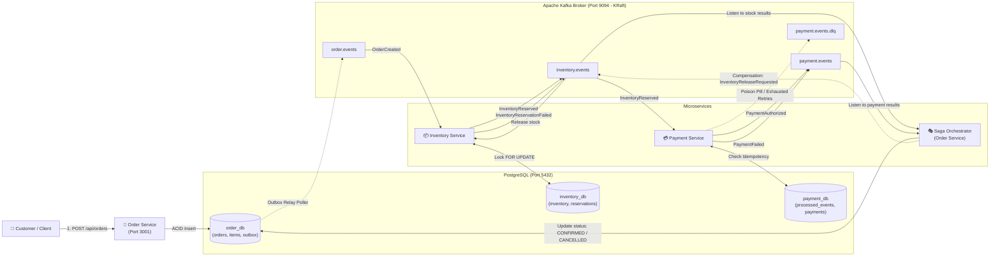

# 🚀 Distributed Order Management System (OMS)

An enterprise-grade, event-driven Distributed Order Management System built with **Node.js, TypeScript, Apache Kafka (KRaft mode), PostgreSQL, Fastify, OpenTelemetry, Jaeger**, and **pnpm workspaces**.

Designed to demonstrate state-of-the-art distributed systems engineering patterns including **Transactional Outbox, Orchestrated Saga with Compensating Transactions, Pessimistic Row Locking, Idempotent Consumers, Dead Letter Queues (DLQ), and Distributed Context Propagation**.

---

## 📚 Complete Documentation Suite

Whether you are an experienced architect or completely new to distributed systems, this repository contains exhaustive guides:

| Document | Focus Area | Description |
| :--- | :--- | :--- |
| 📘 **[Beginner's Guide](docs/BEGINNERS_GUIDE.md)** | Core Concepts & Primer | **Start here if you are new!** Explains Kafka, PNPM monorepos, Sagas, Outbox, Idempotency, DLQ, and Docker in plain English. |
| 🔄 **[Workflows & Flowcharts](docs/WORKFLOWS_AND_FLOWCHARTS.md)** | Visual Diagrams | Detailed Mermaid sequence diagrams and state machines for Happy Path, Out-of-Stock, Compensation, and DLQ flows. |
| 🏛️ **[Architecture Blueprint](docs/ARCHITECTURE.md)** | Technical Design | System design principles, data schemas, envelope specifications, and trade-off analysis. |
| 🧪 **[Testing Runbook](docs/TESTING_RUNBOOK.md)** | Operations & Verification | Step-by-step cURL commands, expected log outputs, DB queries, and troubleshooting tips. |
| 📖 **[API & Swagger UI Guide](docs/API_AND_SWAGGER_GUIDE.md)** | OpenAPI & Interactive UI | Complete guide to live Swagger UI dashboards on each port, OpenAPI 3.0 specs, and Postman import. |
| 📜 **[Event Contracts README](packages/event-contracts/README.md)** | Shared Library | Zod schemas, resilient consumer utilities, and OpenTelemetry helpers. |
| 🛒 **[Order Service README](apps/order-service/README.md)** | Microservice | Fastify HTTP API, Transactional Outbox Relay, and Saga Orchestrator. |
| 📦 **[Inventory Service README](apps/inventory-service/README.md)** | Microservice | Pessimistic locking stock reservation and compensating release. |
| 💳 **[Payment Service README](apps/payment-service/README.md)** | Microservice | Idempotent payment processing, DLQ handling, and CLI replay utility. |
| 🏗️ **[Infrastructure README](infrastructure/README.md)** | DevOps & Containers | Docker Compose setup for PostgreSQL, Kafka KRaft, Kafka UI, and Jaeger. |

---

## 🏛️ High-Level System Architecture



---

## 💡 Technologies Used & Why

If you are unfamiliar with any of these tools, here is why each was chosen:

### 1. PNPM & Monorepo (`pnpm-workspace.yaml`)
- **What is it?** A high-performance package manager that uses hard links and a content-addressable disk store.
- **Why use it?** Enables managing all microservices and shared code in a single repository while sharing `@oms/event-contracts: workspace:*` directly without publishing to npm registry.

### 2. Apache Kafka (KRaft Mode)
- **What is it?** A distributed, append-only, partitioned commit log.
- **Why use it?** Decouples microservices asynchronously. Messages are persisted on disk, allowing services to process events at their own pace. **KRaft mode** eliminates the need for ZooKeeper, making Kafka faster and simpler to run.

### 3. PostgreSQL 16
- **What is it?** A powerful relational database providing ACID transactions.
- **Why use it?** Ensures that local service transactions (e.g. order placement + outbox event) are atomic and consistent. In this project, each microservice has its own isolated database schema.

### 4. Fastify
- **What is it?** A lightweight, extremely fast Node.js HTTP web framework.
- **Why use it?** Serves HTTP endpoints with low overhead and built-in schema-based routing.

### 5. OpenTelemetry & Jaeger
- **What is it?** Open-standard observability framework and distributed tracing UI.
- **Why use it?** Tracks asynchronous requests across HTTP calls and Kafka topic hops using W3C `traceparent` headers. View end-to-end trace waterfalls at `http://localhost:16686`.

### 6. Kafka UI
- **What is it?** A modern web interface for Apache Kafka.
- **Why use it?** Allows viewing topics, consumer lag, partition offsets, and message payloads visually at `http://localhost:8080`.

---

## 🧩 Core Distributed Systems Patterns

### 1. Transactional Outbox Pattern
Solves the **Dual-Write Problem**. When creating an order, inserting the order into `orders` and publishing to Kafka cannot be done in a single distributed transaction.  
**Solution:** The order and an `outbox_events` record are saved inside **one atomic PostgreSQL transaction**. A background worker polls unpublished events with `FOR UPDATE SKIP LOCKED` and publishes them to Kafka.

### 2. Orchestrated Saga Pattern
When a transaction spans multiple services, traditional two-phase commit (2PC) does not scale.  
**Solution:** The Order Service acts as the **Saga Orchestrator**:
- Happy Path: `OrderCreated` $\to$ `InventoryReserved` $\to$ `PaymentAuthorized` $\to$ Order `CONFIRMED`.
- Failure & Compensation: If Payment fails, the orchestrator transitions the order to `COMPENSATING` and publishes `InventoryReleaseRequested`. Inventory Service returns the items back to available stock, and the order is marked `CANCELLED`.

### 3. Pessimistic Row Locking (`FOR UPDATE`)
Flash sales can lead to overselling if two customers buy the last item simultaneously.  
**Solution:** Inventory Service locks the SKU row with `SELECT ... FOR UPDATE`, guaranteeing that stock checks and decrements are strictly serialized and atomic.

### 4. Idempotent Consumer Pattern
Kafka guarantees **At-Least-Once** delivery, meaning duplicate messages can occur.  
**Solution:** Payment Service checks incoming `eventId` against a PostgreSQL `processed_events` table with a primary key constraint. Duplicate events trigger error code `23505` (`unique_violation`) and are skipped safely without duplicate charges.

### 5. Resilient Consumer & Dead Letter Queue (DLQ)
Poison pill messages (corrupt JSON or unhandled exceptions) can cause consumers to crash repeatedly.  
**Solution:** `runResilientConsumer` validates JSON, catches errors, retries up to 3 times with exponential backoff (500ms, 1000ms, 2000ms), and routes exhausted failures to `payment.events.dlq`. Operators can replay dead letters using `pnpm dlq:replay`.

### 6. Distributed Tracing over Kafka Headers
Preserves request context across asynchronous message boundaries.  
**Solution:** `injectTraceHeaders()` injects W3C `traceparent` headers into Kafka records, and `extractTraceContext()` extracts them in downstream consumers, connecting all spans in Jaeger.

---

## 🌐 Unified REST API Directory

Each microservice exposes a dedicated, high-performance REST API with built-in CORS support:

### 🛒 Order Service (`http://localhost:3001`)
| Method | Endpoint | Description |
| :--- | :--- | :--- |
| `GET` | `/health` | Service health status & timestamp |
| `GET` | `/api/orders/stats/summary` | Executive summary (counts by status, total & confirmed revenue) |
| `GET` | `/api/orders` | List orders with pagination (`limit`, `offset`) and filters (`status`, `customerId`) |
| `GET` | `/api/orders/:id` | Fetch complete order details, line items, and outbox publication history |
| `POST` | `/api/orders` | Create a new order (initiates Transactional Outbox & Saga) |
| `POST` | `/api/orders/:id/cancel` | Cancel an order (triggers Saga compensation & automatic inventory release) |

### 📦 Inventory Service (`http://localhost:3002`)
| Method | Endpoint | Description |
| :--- | :--- | :--- |
| `GET` | `/health` | Service health status & timestamp |
| `GET` | `/api/inventory` | List all catalog SKUs with available & reserved stock counts |
| `GET` | `/api/inventory/:sku` | Get real-time stock details for a single SKU |
| `POST` | `/api/inventory` | Register a new product SKU into warehouse catalog |
| `POST` | `/api/inventory/:sku/restock` | Restock an item (atomically increments available stock) |
| `GET` | `/api/inventory/reservations` | List stock reservations with filters (`orderId`, `status`) |
| `GET` | `/api/inventory/reservations/:orderId` | View reservation records for a specific order |

### 💳 Payment Service (`http://localhost:3003`)
| Method | Endpoint | Description |
| :--- | :--- | :--- |
| `GET` | `/health` | Service health status & timestamp |
| `GET` | `/api/payments/stats` | Transaction statistics (authorized vs failed counts and volume) |
| `GET` | `/api/payments` | List payment transactions with filters (`status`, `orderId`) |
| `GET` | `/api/payments/:id` | Get payment record by payment UUID |
| `GET` | `/api/payments/order/:orderId` | Get payment details for a specific order |
| `GET` | `/api/payments/processed-events` | Audit log of processed Kafka events (idempotency store) |
| `POST` | `/api/payments/dlq/replay` | Trigger Dead Letter Queue replay directly via REST API |

---

## ⚡ Quick Start Guide

### Prerequisites
- [Node.js](https://nodejs.org/) v20+
- [pnpm](https://pnpm.io/) v9+ (`npm install -g pnpm`)
- [Docker Desktop](https://www.docker.com/)

### Step 1: Clone & Install Dependencies
```bash
# In the project root
pnpm install
```

### Step 2: Start Infrastructure Containers
```bash
docker compose up -d
```
Verify containers are running:
```bash
docker compose ps
```
- PostgreSQL: `localhost:5432`
- Kafka (KRaft): `localhost:9094`
- Kafka UI: `http://localhost:8080`
- Jaeger UI: `http://localhost:16686`

### Step 3: Build Shared Contracts
```bash
cd packages/event-contracts
pnpm build
cd ../..
```

### Step 4: Start All Microservices
Open three separate terminal windows:

**Terminal 1 — Order Service:**
```bash
cd apps/order-service
pnpm dev
```

**Terminal 2 — Inventory Service:**
```bash
cd apps/inventory-service
pnpm dev
```

**Terminal 3 — Payment Service:**
```bash
cd apps/payment-service
pnpm dev
```

---

## 🧪 Testing the Workflows

### Test 1: The Happy Path (Complete Order Success)
Place an order for 1 MacBook (₹1,50,000):
```bash
curl -X POST http://localhost:3001/api/orders \
  -H "Content-Type: application/json" \
  -d '{
    "customerId": "cust-alice",
    "items": [
      { "sku": "macbook-m3", "quantity": 1, "unitPrice": 150000 }
    ]
  }'
```
**Result:**
- Fastify returns `201 Created (status: PENDING)`.
- Outbox relay publishes `OrderCreated`.
- Inventory Service reserves 1 unit and emits `InventoryReserved`.
- Payment Service authorizes ₹1,50,000 and emits `PaymentAuthorized`.
- Saga Orchestrator updates order status to `CONFIRMED`.

### Test 2: Inventory Out-of-Stock Failure
Order 99 units (exceeding stock of 5):
```bash
curl -X POST http://localhost:3001/api/orders \
  -H "Content-Type: application/json" \
  -d '{
    "customerId": "cust-bob",
    "items": [
      { "sku": "macbook-m3", "quantity": 99, "unitPrice": 150000 }
    ]
  }'
```
**Result:**
- Inventory Service detects stock shortage and emits `InventoryReservationFailed`.
- Saga Orchestrator updates order to `CANCELLED` with reason `Insufficient stock`. Payment is never invoked.

### Test 3: Payment Limit Exceeded & Compensation Rollback
Order 4 MacBooks (Total: ₹6,00,000 > ₹5,00,000 limit):
```bash
curl -X POST http://localhost:3001/api/orders \
  -H "Content-Type: application/json" \
  -d '{
    "customerId": "cust-charlie",
    "items": [
      { "sku": "macbook-m3", "quantity": 4, "unitPrice": 150000 }
    ]
  }'
```
**Result:**
- Inventory Service reserves 4 units and emits `InventoryReserved`.
- Payment Service rejects transaction (> ₹5,00,000) and emits `PaymentFailed`.
- Saga Orchestrator updates order to `COMPENSATING` and publishes `InventoryReleaseRequested`.
- Inventory Service returns 4 units back to available shelf stock and emits `InventoryReleased`.
- Saga Orchestrator transitions order to `CANCELLED`. Stock is safely restored!

### Test 4: Idempotency Duplicate Event Test
```bash
cd apps/payment-service
pnpm tsx src/test-duplicate.ts
```
**Result:**
Payment Service detects duplicate `eventId` via PostgreSQL error `23505`, logs a duplicate warning, and skips without double billing.

### Test 5: Dead Letter Queue (DLQ) Replay
```bash
cd apps/payment-service
pnpm dlq:replay
```
**Result:**
Scans `payment.events.dlq`, formats replayed envelopes with audit headers, and safely routes messages back to the active topic.

---

## 🔍 Observability Portals

- **Kafka UI:** Visit [http://localhost:8080](http://localhost:8080) to inspect topics, message payloads, consumer groups, and lag.
- **Jaeger Tracing:** Visit [http://localhost:16686](http://localhost:16686) to trace requests across microservices.

---

## 📂 Project Structure

```
distributed-oms/
├── README.md                  # Master documentation & entry point
├── package.json               # Root monorepo configuration
├── pnpm-workspace.yaml        # Workspace configuration
├── pnpm-lock.yaml             # Lockfile
├── tsconfig.base.json         # Base TypeScript configuration
├── docker-compose.yml         # Postgres, Kafka KRaft, Kafka UI, Jaeger
│
├── docs/                      # In-depth architectural & testing guides
│   ├── BEGINNERS_GUIDE.md     # Plain-English guide for Kafka, Monorepo, Sagas
│   ├── WORKFLOWS_AND_FLOWCHARTS.md # Mermaid sequence diagrams & state machines
│   ├── ARCHITECTURE.md        # Technical architecture blueprint
│   └── TESTING_RUNBOOK.md     # Complete testing & verification runbook
│
├── packages/
│   └── event-contracts/       # Shared TypeScript schemas & utilities
│       ├── README.md
│       ├── package.json
│       ├── tsconfig.json
│       └── src/
│           ├── index.ts              # Zod schemas, event types, topic constants
│           ├── resilientConsumer.ts  # Generic retry + backoff + DLQ consumer wrapper
│           ├── tracer.ts             # OpenTelemetry NodeSDK setup
│           └── tracingContext.ts     # Kafka header W3C trace injection/extraction
│
├── apps/
│   ├── order-service/         # Order ingestion & Saga Orchestration
│   │   ├── README.md
│   │   ├── package.json
│   │   └── src/
│   │       ├── index.ts              # Fastify HTTP server (POST /api/orders)
│   │       ├── sagaOrchestrator.ts   # Saga state machine
│   │       ├── outboxRelay.ts        # Transactional outbox polling relay
│   │       ├── kafka.ts              # KafkaJS client & producer
│   │       └── db/
│   │           ├── connection.ts     # PostgreSQL connection pool
│   │           └── init.ts           # Schema migration script
│   │
│   ├── inventory-service/     # Inventory management & stock reservation
│   │   ├── README.md
│   │   ├── package.json
│   │   └── src/
│   │       ├── index.ts              # Stock reservation & pessimistic locks
│   │       └── db/
│   │           ├── connection.ts     # PostgreSQL connection pool
│   │           └── init.ts           # Schema migration & seed data
│   │
│   └── payment-service/       # Payment authorization & DLQ management
│       ├── README.md
│       ├── package.json
│       └── src/
│           ├── index.ts              # Idempotent payment processor
│           ├── replay-dlq.ts         # DLQ replay CLI utility
│           ├── test-duplicate.ts     # Idempotency test runner
│           └── db/
│               ├── connection.ts     # PostgreSQL connection pool
│               └── init.ts           # Schema migration script
│
└── infrastructure/            # Docker Compose & database bootstrap
    ├── README.md
    └── docker/
        └── init-databases.sql # PostgreSQL multi-database initializer
```
