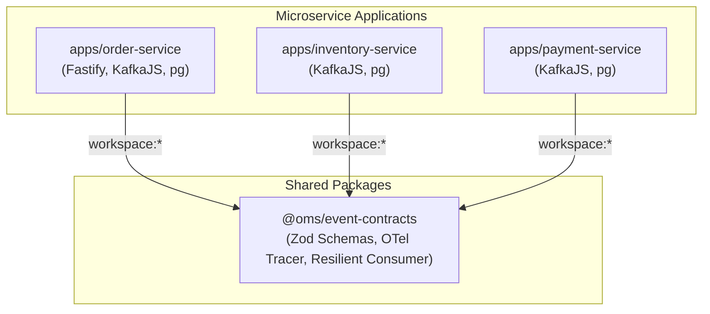

# 🏛️ Distributed OMS — Architecture & System Design Document

This document provides a comprehensive technical architecture blueprint of the **Distributed Order Management System (OMS)**. It covers design principles, monorepo organization, event envelope specifications, database schemas, resilience strategies, and distributed tracing.

---

## 📑 Table of Contents
1. [Architectural Overview & Core Principles](#1-architectural-overview--core-principles)
2. [Monorepo & Package Dependency Architecture](#2-monorepo--package-dependency-architecture)
3. [Event Contracts & Message Envelope Specification](#3-event-contracts--message-envelope-specification)
4. [Database Schemas & Data Model Design](#4-database-schemas--data-model-design)
5. [Distributed Systems Patterns in Detail](#5-distributed-systems-patterns-in-detail)
6. [Observability & Distributed Tracing Architecture](#6-observability--distributed-tracing-architecture)
7. [Fault Tolerance & Failure Modes Analysis](#7-fault-tolerance--failure-modes-analysis)

---

## 1. Architectural Overview & Core Principles

The Distributed OMS is designed following **Event-Driven Architecture (EDA)** principles, microservices separation of concerns, and asynchronous messaging:

1. **Database-per-Service:** Each microservice (`order-service`, `inventory-service`, `payment-service`) owns its own isolated PostgreSQL database schema. No cross-service foreign keys or database queries are allowed.
2. **Asynchronous Decoupling:** Services interact exclusively through Apache Kafka topics using strongly typed event contracts.
3. **Atomic State Updates & Dual-Write Prevention:** Services never write to their database and call Kafka in separate non-atomic steps. The Transactional Outbox pattern guarantees that events are only emitted if the database transaction commits.
4. **Eventual Consistency via Sagas:** Cross-service consistency is achieved via an **Orchestrated Saga** managed by the Order Service.
5. **Idempotent Consumers:** Every event consumer defensively deduplicates incoming messages against a local persistent store to handle Kafka's At-Least-Once delivery semantics.
6. **Poison Pill Isolation:** Non-parseable or repeatedly failing messages are automatically routed to Dead Letter Queues (DLQ) after exponential backoff.
7. **End-to-End Tracing:** W3C TraceContext headers are propagated through Kafka message headers, providing full distributed tracing across asynchronous boundaries in Jaeger.

---

## 2. Monorepo & Package Dependency Architecture

The repository uses **pnpm workspaces** to coordinate services and shared libraries:

```
distributed-oms/
├── pnpm-workspace.yaml        # Declares apps/* and packages/*
├── package.json               # Root dependencies & OTel packages
├── tsconfig.base.json         # Base TypeScript configuration
├── docker-compose.yml         # Postgres, Kafka KRaft, Kafka UI, Jaeger
│
├── packages/
│   └── event-contracts/       # Shared TypeScript schemas, types, OTel utilities
│       ├── package.json       # @oms/event-contracts
│       └── src/
│           ├── index.ts              # Zod schemas, event types, topic constants
│           ├── resilientConsumer.ts  # Generic retry + backoff + DLQ consumer wrapper
│           ├── tracer.ts             # OpenTelemetry NodeSDK initialization
│           └── tracingContext.ts     # Kafka header W3C injection & extraction
│
├── apps/
│   ├── order-service/         # Fastify API, Outbox poller, Saga Orchestrator
│   ├── inventory-service/     # Pessimistic locking, stock allocation & release
│   └── payment-service/       # Idempotent payment processor, DLQ replayer
│
├── infrastructure/
│   └── docker/
│       └── init-databases.sql # PostgreSQL multi-database bootstrap
└── docs/                      # Comprehensive technical guides & runbooks
```

### Dependency Graph



---

## 3. Event Contracts & Message Envelope Specification

All events in the distributed system inherit from a standardized **Event Envelope Schema** validated using **Zod** in [packages/event-contracts/src/index.ts](file:///d:/Projects/distributed-oms/packages/event-contracts/src/index.ts).

### The Base Envelope (`EventEnvelopeSchema`)
Every Kafka message must strictly conform to:

```typescript
{
  eventId: string;        // UUIDv4: Unique per message instance. Used for consumer deduplication.
  eventType: string;      // Literal name of domain event (e.g. 'OrderCreated', 'InventoryReserved')
  aggregateId: string;    // Core entity ID (orderId). Used as Kafka partition key for FIFO ordering.
  correlationId: string;  // Trace identifier shared across the entire multi-service lifecycle.
  causationId: string;    // eventId of the immediate message that triggered this event.
  timestamp: string;      // ISO 8601 UTC timestamp.
  version: number;        // Schema version (default: 1) for schema evolution.
  producer: string;       // Service name that produced the event (e.g., 'order-service').
  payload: object;        // Domain-specific typed data.
}
```

### Kafka Topics Matrix

| Topic Name | Producer(s) | Primary Consumer(s) | Purpose |
| :--- | :--- | :--- | :--- |
| `order.events` | `order-service` (Outbox Relay) | `inventory-service` | Signals a new customer order has been registered. |
| `inventory.events` | `inventory-service`, `order-service` (Saga) | `payment-service`, `saga-orchestrator`, `inventory-service` | Communicates stock reservation success, stock failure, or inventory release compensation commands. |
| `payment.events` | `payment-service` | `saga-orchestrator` | Signals payment authorization or failure. |
| `payment.events.dlq` | `resilientConsumer` (Payment) | `replay-dlq` CLI | Dead Letter Queue holding unprocessable payment messages. |

### Domain Event Payloads

#### 1. `OrderCreated` (`order.events`)
```json
{
  "orderId": "3fa85f64-5717-4562-b3fc-2c963f66afa6",
  "customerId": "cust-90210",
  "items": [
    { "sku": "macbook-m3", "quantity": 1, "unitPrice": 150000 }
  ],
  "totalAmount": 150000,
  "currency": "INR"
}
```

#### 2. `InventoryReserved` (`inventory.events`)
```json
{
  "orderId": "3fa85f64-5717-4562-b3fc-2c963f66afa6",
  "items": [
    { "sku": "macbook-m3", "quantity": 1, "unitPrice": 150000 }
  ],
  "totalAmount": 150000
}
```

#### 3. `InventoryReservationFailed` (`inventory.events`)
```json
{
  "orderId": "3fa85f64-5717-4562-b3fc-2c963f66afa6",
  "reason": "Insufficient stock for macbook-m3. Requested: 10, Available: 4",
  "items": [{ "sku": "macbook-m3", "quantity": 10, "unitPrice": 150000 }]
}
```

#### 4. `PaymentAuthorized` (`payment.events`)
```json
{
  "orderId": "3fa85f64-5717-4562-b3fc-2c963f66afa6",
  "paymentId": "7c9e6679-7425-40de-944b-e07fc1f90ae7",
  "amount": 150000,
  "currency": "INR"
}
```

#### 5. `PaymentFailed` (`payment.events`)
```json
{
  "orderId": "3fa85f64-5717-4562-b3fc-2c963f66afa6",
  "reason": "Transaction amount ₹600000 exceeds allowed limit of ₹5,00,000",
  "amount": 600000
}
```

#### 6. `InventoryReleaseRequested` (`inventory.events`)
```json
{
  "orderId": "3fa85f64-5717-4562-b3fc-2c963f66afa6",
  "reason": "Transaction amount ₹600000 exceeds allowed limit of ₹5,00,000"
}
```

#### 7. `InventoryReleased` (`inventory.events`)
```json
{
  "orderId": "3fa85f64-5717-4562-b3fc-2c963f66afa6",
  "reason": "Transaction amount ₹600000 exceeds allowed limit of ₹5,00,000"
}
```

---

## 4. Database Schemas & Data Model Design

The system runs on PostgreSQL 16. In development, a single Postgres instance hosts 3 isolated databases.

### Database 1: `order_db` ([apps/order-service/src/db/init.ts](file:///d:/Projects/distributed-oms/apps/order-service/src/db/init.ts))

```sql
-- Orders Master Table
CREATE TABLE orders (
  id UUID PRIMARY KEY,
  customer_id VARCHAR(100) NOT NULL,
  status VARCHAR(50) NOT NULL, -- PENDING, CONFIRMED, COMPENSATING, CANCELLED
  total_amount NUMERIC(12, 2) NOT NULL,
  currency VARCHAR(3) DEFAULT 'INR',
  cancellation_reason TEXT,
  created_at TIMESTAMPTZ DEFAULT NOW(),
  updated_at TIMESTAMPTZ DEFAULT NOW()
);

-- Line Items Table
CREATE TABLE order_items (
  id UUID PRIMARY KEY,
  order_id UUID NOT NULL REFERENCES orders(id) ON DELETE CASCADE,
  sku VARCHAR(100) NOT NULL,
  quantity INT NOT NULL CHECK (quantity > 0),
  unit_price NUMERIC(12, 2) NOT NULL CHECK (unit_price > 0)
);

-- Transactional Outbox Table
CREATE TABLE outbox_events (
  id UUID PRIMARY KEY,
  aggregate_type VARCHAR(50) NOT NULL,
  aggregate_id VARCHAR(100) NOT NULL,
  event_type VARCHAR(100) NOT NULL,
  payload JSONB NOT NULL,
  headers JSONB DEFAULT '{}'::jsonb,
  created_at TIMESTAMPTZ DEFAULT NOW(),
  published_at TIMESTAMPTZ NULL,
  retry_count INT DEFAULT 0
);

-- High-performance partial index for the outbox relay
CREATE INDEX idx_outbox_unpublished 
ON outbox_events (created_at) 
WHERE published_at IS NULL;
```

### Database 2: `inventory_db` ([apps/inventory-service/src/db/init.ts](file:///d:/Projects/distributed-oms/apps/inventory-service/src/db/init.ts))

```sql
-- Stock Catalog & Availability
CREATE TABLE inventory (
  sku VARCHAR(100) PRIMARY KEY,
  name VARCHAR(255) NOT NULL,
  available_quantity INT NOT NULL CHECK (available_quantity >= 0),
  reserved_quantity INT NOT NULL DEFAULT 0 CHECK (reserved_quantity >= 0),
  updated_at TIMESTAMPTZ DEFAULT NOW()
);

-- Order-to-Stock Allocation Log
CREATE TABLE inventory_reservations (
  id UUID PRIMARY KEY,
  order_id UUID NOT NULL,
  sku VARCHAR(100) NOT NULL REFERENCES inventory(sku),
  quantity INT NOT NULL,
  status VARCHAR(50) NOT NULL, -- RESERVED, RELEASED, CONFIRMED
  created_at TIMESTAMPTZ DEFAULT NOW()
);

-- Seed Data
INSERT INTO inventory (sku, name, available_quantity, reserved_quantity)
VALUES 
  ('macbook-m3', 'Apple MacBook Pro M3', 5, 0),
  ('keyboard-mech', 'Mechanical Gaming Keyboard', 10, 0)
ON CONFLICT (sku) DO NOTHING;
```

### Database 3: `payment_db` ([apps/payment-service/src/db/init.ts](file:///d:/Projects/distributed-oms/apps/payment-service/src/db/init.ts))

```sql
-- Idempotency Deduplication Table
CREATE TABLE processed_events (
  event_id UUID PRIMARY KEY,
  consumer_name VARCHAR(100) NOT NULL,
  processed_at TIMESTAMPTZ DEFAULT NOW()
);

-- Transactions Ledger
CREATE TABLE payments (
  id UUID PRIMARY KEY,
  order_id UUID NOT NULL,
  amount NUMERIC(12, 2) NOT NULL,
  currency VARCHAR(3) NOT NULL,
  status VARCHAR(50) NOT NULL, -- AUTHORIZED, FAILED
  created_at TIMESTAMPTZ DEFAULT NOW()
);
```

---

## 5. Distributed Systems Patterns in Detail

### 1. Transactional Outbox Pattern
- **Why?** Directly publishing to Kafka inside the HTTP controller risks lost events or orphan records if the network or process dies between the DB write and Kafka write.
- **Implementation:** In [apps/order-service/src/index.ts](file:///d:/Projects/distributed-oms/apps/order-service/src/index.ts), `orders`, `order_items`, and `outbox_events` are inserted inside a single `BEGIN ... COMMIT` block.
- **Relay Mechanism:** [apps/order-service/src/outboxRelay.ts](file:///d:/Projects/distributed-oms/apps/order-service/src/outboxRelay.ts) polls `outbox_events` using `SELECT ... FOR UPDATE SKIP LOCKED`. If multiple Order Service replicas run concurrently, `SKIP LOCKED` ensures each instance claims distinct rows without blocking or deadlock!

### 2. Pessimistic Row Locking for Inventory
- **Why?** In a high-traffic flash sale, two customers might attempt to buy the last unit of `macbook-m3` simultaneously. Without locking, both might read `available_quantity = 1`, and both would succeed in reserving it, resulting in a negative inventory balance!
- **Implementation:** In [apps/inventory-service/src/index.ts](file:///d:/Projects/distributed-oms/apps/inventory-service/src/index.ts):
  ```sql
  SELECT available_quantity, reserved_quantity 
  FROM inventory 
  WHERE sku = $1 
  FOR UPDATE;
  ```
  Postgres locks the row exclusively for that transaction until `COMMIT` or `ROLLBACK`. The second request waits until the first finishes, seeing the updated stock count of 0.

### 3. Idempotent Consumer Pattern
- **Why?** Kafka guarantees At-Least-Once delivery. Network timeouts or rebalances can cause a consumer to re-process an event.
- **Implementation:** In [apps/payment-service/src/index.ts](file:///d:/Projects/distributed-oms/apps/payment-service/src/index.ts), the consumer inserts the incoming `event.eventId` into the `processed_events` table before charging. If `event_id` already exists, Postgres rejects it with error code `23505` (`unique_violation`). The service catches this error, logs a duplicate warning, and gracefully returns without executing double payment.

### 4. Orchestrated Saga Pattern
- **Why?** To manage transactions that span across Order, Inventory, and Payment databases without locking distributed resources.
- **Implementation:** [apps/order-service/src/sagaOrchestrator.ts](file:///d:/Projects/distributed-oms/apps/order-service/src/sagaOrchestrator.ts) subscribes to `inventory.events` and `payment.events`:
  - `PaymentAuthorized` -> Marks order `CONFIRMED`.
  - `InventoryReservationFailed` -> Marks order `CANCELLED`.
  - `PaymentFailed` -> Marks order `COMPENSATING`, emits `InventoryReleaseRequested`.
  - `InventoryReleased` -> Marks order `CANCELLED`.

---

## 6. Observability & Distributed Tracing Architecture

We use **OpenTelemetry (OTel)** with the **OTLP HTTP Exporter** sending traces to **Jaeger**.

### Trace Context Propagation over Kafka Headers
When messages travel through Kafka, HTTP headers are lost. We bridge this gap using W3C TraceContext standards:
1. **Producer Side:** In [packages/event-contracts/src/tracingContext.ts](file:///d:/Projects/distributed-oms/packages/event-contracts/src/tracingContext.ts), `injectTraceHeaders()` captures the active OpenTelemetry context and encodes it as a `traceparent` header (e.g., `00-4bf92f3577b34da6a3ce929d0e0e4736-00f067aa0ba902b7-01`).
2. **Kafka Message Headers:** The `traceparent` string is passed in the Kafka message headers object.
3. **Consumer Side:** `extractTraceContext()` decodes the `traceparent` header, restoring the parent span context so child spans are grouped under the exact same Trace ID.
4. **Visualisation:** Open `http://localhost:16686` to see complete flame graphs and waterfall timelines of requests across all three services.

---

## 7. Fault Tolerance & Failure Modes Analysis

| Failure Scenario | System Behavior | Recovery Mechanism |
| :--- | :--- | :--- |
| **Crash right after Order created** | Order and Outbox record are already safely in Postgres. | When Order Service restarts, the Outbox Relay worker reads the unpublished row and publishes it to Kafka. Zero data loss. |
| **Kafka Broker temporary downtime** | Outbox Relay catches Kafka connection errors, rolls back the batch, and retries on next 1-second interval. | Outbox records accumulate safely in Postgres until Kafka recovers. |
| **Payment Service crashes mid-processing** | Database transaction rolls back; Kafka offset is not committed. | Kafka assigns partition to another consumer or redelivers when service restarts. Idempotency table prevents duplicate billing. |
| **Malformed JSON / Poison Pill message** | `runResilientConsumer` catches parse error before crashing. | Immediately shunted to `payment.events.dlq`. Service continues running normal traffic. |
| **Transient Database connection error in Payment** | `runResilientConsumer` catches error and applies exponential backoff (500ms, 1000ms, 2000ms). | Up to 3 retries. If DB recovers within seconds, message succeeds. If exhausted, sent to DLQ. |
| **Insufficient stock for Order** | Inventory Service queries stock with `FOR UPDATE`, detects shortage, emits `InventoryReservationFailed`. | Saga Orchestrator updates order to `CANCELLED`. Customer is notified. Payment is never touched. |
| **Payment amount exceeds ₹5,00,000** | Payment Service rejects transaction, records `FAILED` payment, emits `PaymentFailed`. | Saga Orchestrator transitions order to `COMPENSATING`, emits `InventoryReleaseRequested`. Inventory Service returns stock to available pool and emits `InventoryReleased`. Order transitions to `CANCELLED`. |
