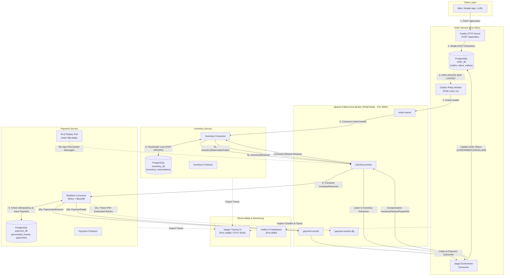
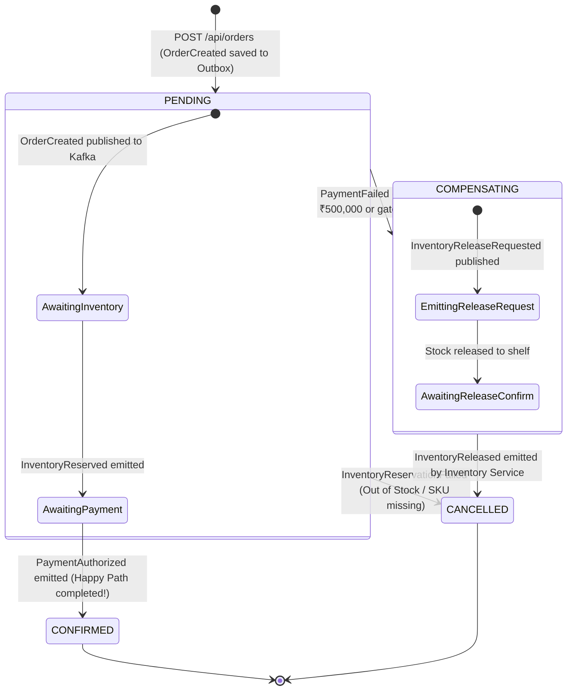
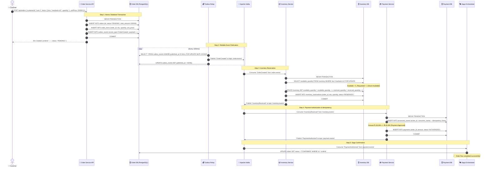
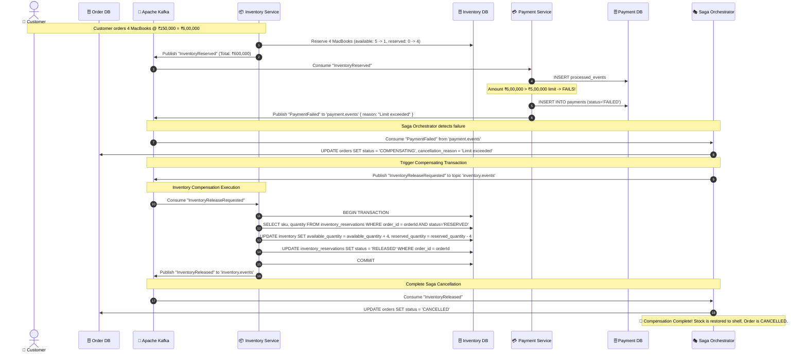
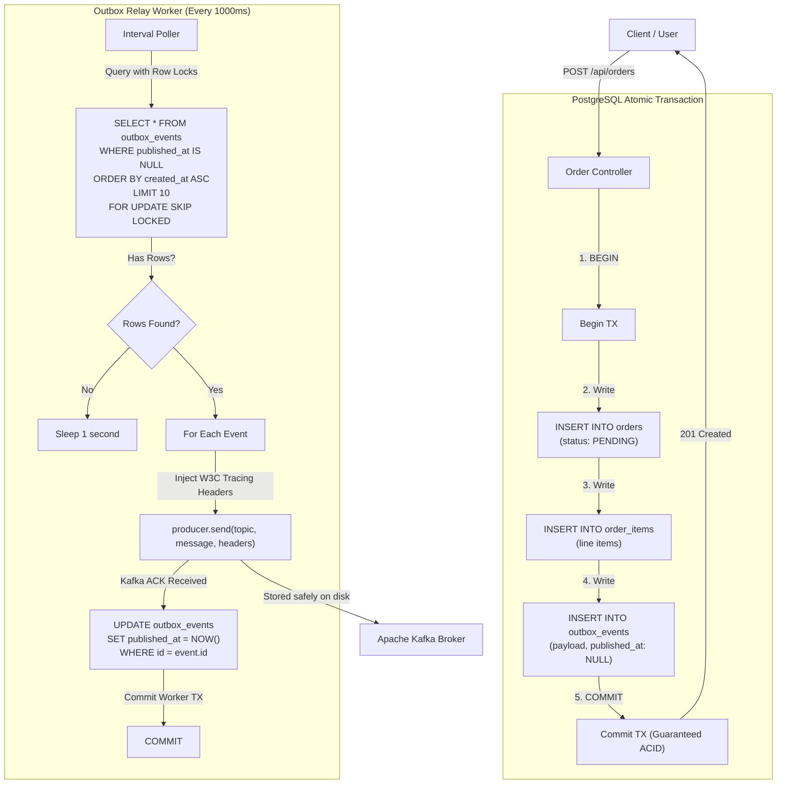
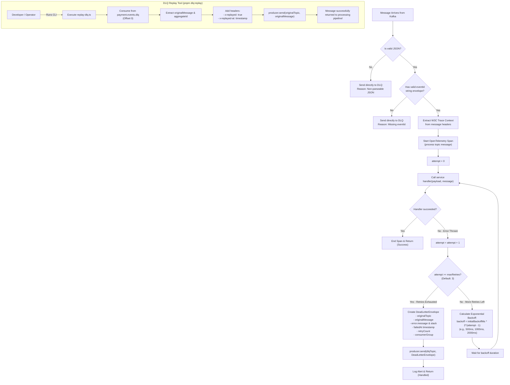
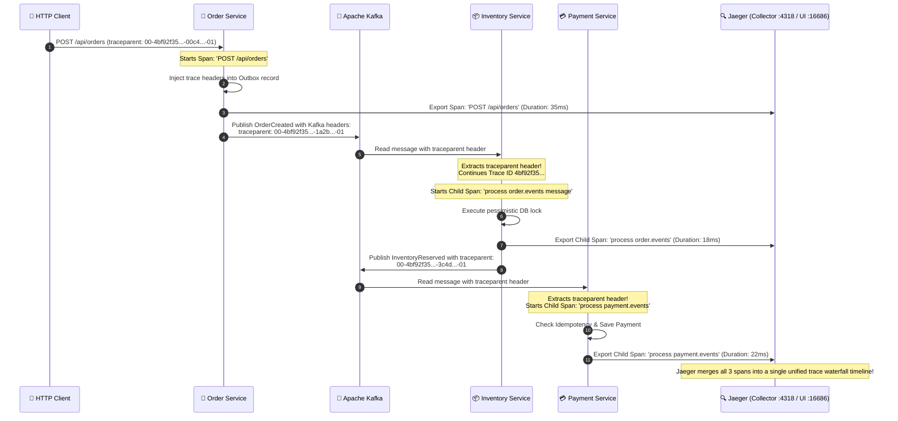

# 🔄 Distributed OMS — Workflows, State Machines & Flowcharts

This document details every transaction flow, failure recovery path, and state machine transition in the Distributed Order Management System using comprehensive Mermaid diagrams and step-by-step explanations.

---

## 📑 Table of Contents
1. [High-Level Architecture Map](#1-high-level-architecture-map)
2. [Order Lifecycle State Machine](#2-order-lifecycle-state-machine)
3. [Workflow 1: The Happy Path (Complete Order Success)](#3-workflow-1-the-happy-path-complete-order-success)
4. [Workflow 2: Inventory Failure Path (Out of Stock)](#4-workflow-2-inventory-failure-path-out-of-stock)
5. [Workflow 3: Payment Failure & Saga Compensation Rollback](#5-workflow-3-payment-failure--saga-compensation-rollback)
6. [Workflow 4: The Transactional Outbox Relay Pattern](#6-workflow-4-the-transactional-outbox-relay-pattern)
7. [Workflow 5: Resilient Consumer, Retry Backoff & DLQ Flow](#7-workflow-5-resilient-consumer-retry-backoff--dlq-flow)
8. [Workflow 6: Distributed Tracing & W3C Context Propagation](#8-workflow-6-distributed-tracing--w3c-context-propagation)

---

## 1. High-Level Architecture Map

The system is organized into three microservices, a shared contract package, a Kafka event backbone with KRaft, PostgreSQL databases, and Jaeger observability.



---

## 2. Order Lifecycle State Machine

Each order transitions through a strictly defined state machine inside the `orders` table in `order_db`.



---

## 3. Workflow 1: The Happy Path (Complete Order Success)

This workflow demonstrates what happens when a customer purchases an in-stock product with a valid payment amount (≤ ₹5,00,000).



---

## 4. Workflow 2: Inventory Failure Path (Out of Stock)

This scenario occurs when the requested quantity exceeds the stock available in `inventory` or if the SKU does not exist.

```mermaid
sequenceDiagram
    autonumber
    actor Customer as 👤 Customer
    participant OrderAPI as 🛒 Order Service API
    participant OrderDB as 🗄️ Order DB
    participant Outbox as 📬 Outbox Relay
    participant Kafka as 📨 Apache Kafka
    participant InvSvc as 📦 Inventory Service
    participant InvDB as 🗄️ Inventory DB
    participant Saga as 🎭 Saga Orchestrator

    Customer->>OrderAPI: POST /api/orders (Requesting 99 units of 'macbook-m3')
    OrderAPI->>OrderDB: INSERT orders (PENDING) + outbox_events (OrderCreated)
    OrderAPI-->>Customer: 201 Created { status: "PENDING" }

    Outbox->>Kafka: Publish "OrderCreated" to 'order.events'
    Kafka->>InvSvc: Consume "OrderCreated"

    InvSvc->>InvDB: BEGIN; SELECT available_quantity FROM inventory WHERE sku='macbook-m3' FOR UPDATE;
    Note over InvDB: Available = 5, Requested = 99 -> INSUFFICIENT STOCK!
    InvSvc->>InvDB: ROLLBACK
    InvSvc->>Kafka: Publish "InventoryReservationFailed" to 'inventory.events' { reason: "Insufficient stock" }

    Kafka->>Saga: Consume "InventoryReservationFailed" from 'inventory.events'
    Saga->>OrderDB: UPDATE orders SET status = 'CANCELLED', cancellation_reason = 'Insufficient stock' WHERE id = orderId
    Note over Saga: ❌ Order cancelled immediately. Payment was never invoked.
```

---

## 5. Workflow 3: Payment Failure & Saga Compensation Rollback

This is the most critical distributed systems scenario: **Inventory was already reserved**, but **Payment subsequently failed** (for example, the total exceeded ₹5,00,000). The Saga Orchestrator must perform a **compensating transaction** to release the reserved items back to the stock shelf.



---

## 6. Workflow 4: The Transactional Outbox Relay Pattern

The Transactional Outbox pattern guarantees that database writes and Kafka events are 100% consistent, solving the dual-write problem.



---

## 7. Workflow 5: Resilient Consumer, Retry Backoff & DLQ Flow

This flowchart describes the error handling, exponential backoff, and Dead Letter Queue mechanism implemented inside [packages/event-contracts/src/resilientConsumer.ts](file:///d:/Projects/distributed-oms/packages/event-contracts/src/resilientConsumer.ts).



---

## 8. Workflow 6: Distributed Tracing & W3C Context Propagation

Tracing enables visibility across all asynchronous boundaries, matching HTTP requests to background Kafka events and database queries.


